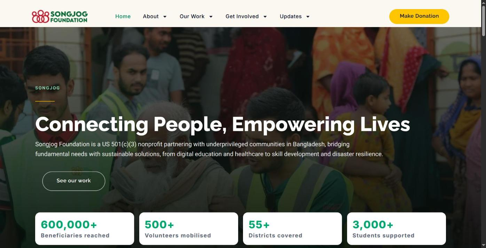
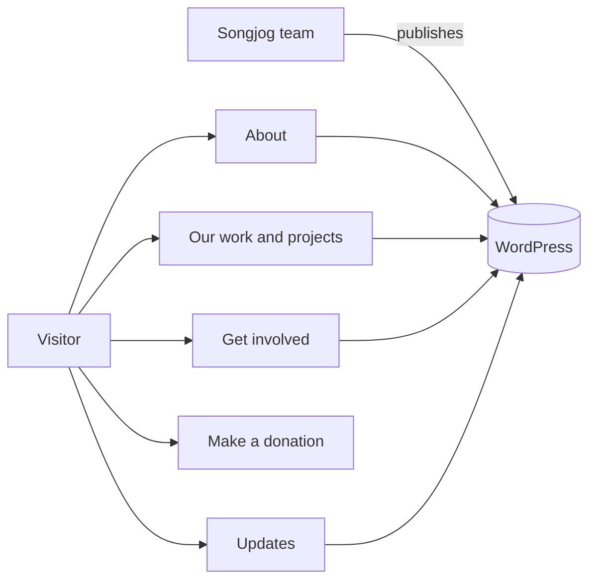

# songjogfoundation.org

[songjogfoundation.org](https://songjogfoundation.org) is the international website of Songjog Foundation, the US 501(c)(3) side of the organization. It tells donors and partners abroad about Songjog's work in Bangladesh: digital education, healthcare, skill development and disaster resilience.

## What changed

The site used to be a single static page. I rebuilt it as a dynamic WordPress site so the team can publish projects and updates on their own, and redesigned it.

## Built with

WordPress

## Status

Live at [songjogfoundation.org](https://songjogfoundation.org).
